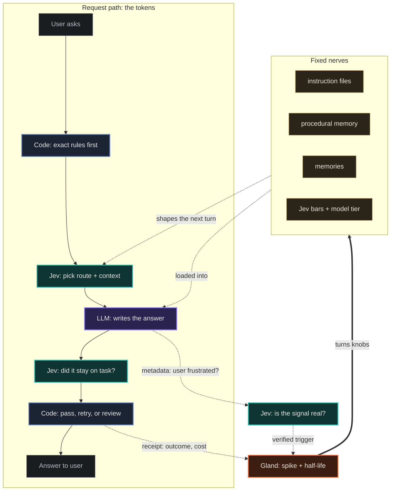

the world was fighting over the best LLM. Then Jev came out of a two year stealth op and shook the world, though I think there's more that's yet to come out. In the span of a few days, someone [beat the ender dragon](https://madewithjev.com/builds/minecraft-ender-dragon) with Jev (plus a model called Astra) in under 9 minutes for less than a dollar of tokens. Jev's share of that bill was one cent.

The sauce is simple. rewrite your brain to only use LLMs for generating custom output. Turns out, we were using LLMs for too much.

Twitter says Diogo Almeida (founder of Jev) released a paper on how to use Jev with LLMs. He didn't. I tracked down the PDF, and it's an independent field guide built off TypeSafe's public docs. Still good though. It goes something like this:

1. **draw the line:** code handles exact rules, Jev handles quick judgment calls, the LLM handles anything open ended
2. **build the state:** only send the evidence that matters right now, name every field, keep untrusted stuff away from instructions
3. **pick the primitive:** Choice picks a route, Score puts it on a scale, Noul gives you the odds something is true
4. **break it up:** one giant eval prompt becomes a bunch of tiny questions, and code stitches the answers together
5. **batch it:** every question reading the same state goes in one call
6. **Jev before the LLM:** filter by policy, then let Jev pick the path before you pay for generation
7. **Jev after the LLM:** tests and schemas first, then Jev checks the output stayed on task
8. **gate by risk:** confident and safe runs on its own, unsure gets reviewed, bad stops
9. **keep receipts:** log every decision, all the way to the outcome
10. **roll out slow:** replay, shadow, assist, then automate one low risk slice

Best line in the whole thing: probability isn't permission. Jev gives you evidence, code still holds the keys.

So. Beyond jev, I have been trying to implement a vibe coded recursive feedback loop to every skill invocation. Already tracking logs and decision trees, so Jev comes in nicely around that. Let me introduce a third type of model that doesn't exist yet, separate to System 1 and 2 models.

I'm calling it Gland for now, because I'm trying to emulate the shifting of the center of balance in a human body through hormonal changes. Yes this is a stretch by any means. Dream with me.

Think of the body. The LLM is muscle: big, strong, expensive to fire. Jev is the tendon: fast, doesn't think, just connects. What's missing is the stuff that makes you jumpy after a near miss and chill again by dinner. Hormones. Hormones don't carry content. Adrenaline doesn't tell you what the snake looked like. It cranks the gain on everything for a while and then clears out. That's Gland. It doesn't output anything. It sits under the other two and turns knobs.

To play that into deterministic code, it's hormones (triggers determined by jev) that have a varying half-life on a fixed cluster of nerves (vector indexed procedural memory, instruction files, memories).

The knobs already exist in every AI stack, they're just hardcoded: temperature, how long the model thinks, how hard it searches, when it asks vs answers, how trigger happy it is with tools. Some knobs stay locked. Refusal sensitivity is off limits, and a config that tries to touch it won't even load. Gland never grants permission. It only moves bars that code already enforces.

Every hormone is three things: a trigger, a target, and a decay. Triggers come from feedback from an LLM that the user is on edge today, for ludicrous example. Or, really, use the existing sycophantic triggers that enable LLMs to determine, "the user is frustrated" or something similar. That frustration signal targets a set number of nodes: if the frustration was about accuracy of data, switch the model/effort from Opus 5.5 Medium to Fable 5.1 Heavy for the next 5 LLM turns. That captures both target and decay. Frustration can make the system try harder. It should never make it agree harder.

Decay is important because, like the human body regulating, for the system to still be the system you designed in the first place, the scalars we put in place need to be able to reset to a default state.

To be honest with you, the gold is at figuring out what those knobs are. Some real examples of knobs:
- Jev's bar: how sure Jev has to be before it acts alone. Default 0.80, and caution pushes it up after a confident miss.
- Model + effort: Opus 5.5 medium by default, bumping to Fable 5.1 heavy when accuracy is taking hits.
- Retrieval depth: how many chunks get pulled from procedural memory per turn.
- Instruction weighting: which instruction files load, and whether the strict ones or the fast ones win.
- Memory write bar: how important something has to be before it gets saved.
- Spine gate: how sure Jev has to be that a request is quick before it skips the spine.
- Tool eagerness: how fast it reaches for a tool vs answering from what it has.
- Locked: refusal sensitivity. Gland can't touch it.

**TLDR:** LLM can do anything. LLMs do too much today. Jev is cheap and makes decisions, so LLM tokens go to optimized work. Gland, a third model, is needed to manage triggers identified from metadata that comes from the LLM (and verified by Jev). Triggers would tell Gland to adjust certain scalars depending on the trigger. Gland manages triggers, the action (adjustment), and decay (half-life). Think inflammation, or logical fallacies like recency bias in humans.

Do we want to introduce human flaws into AI? I couldn't tell you. But I can tell you that a model capable of adjusting scalars in this design is a model that is capable of situational awareness. Read the room type shit.
